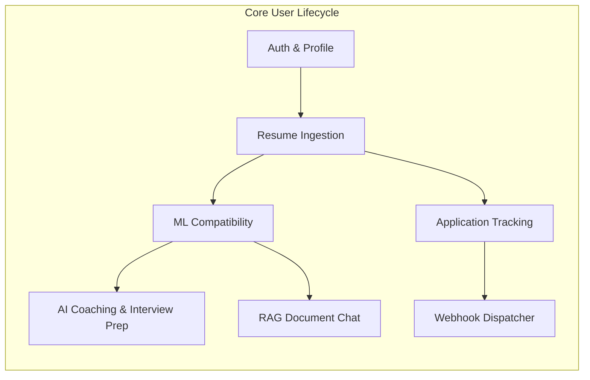
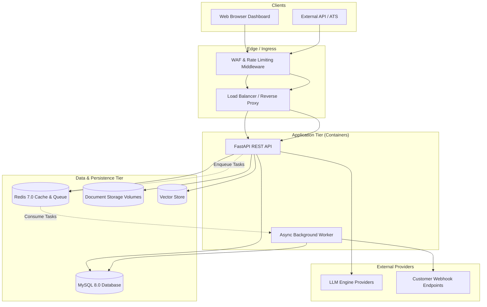
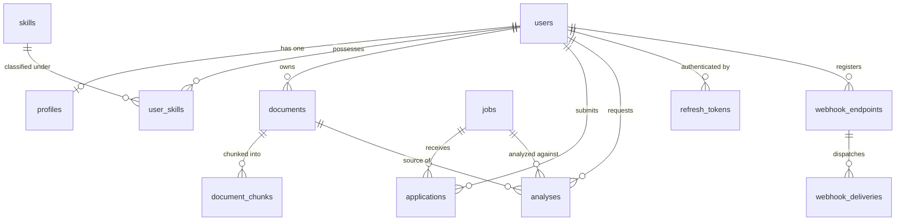

# CareerAI — Product Requirements Document (PRD)

**Document Version:** 1.0.0  
**Status:** Approved / Production Ready  
**Target Platform:** CareerAI Engine & Candidate Intelligence Suite  
**Last Updated:** October 2026  

---

## 1. Executive Summary

### 1.1 Product Vision
**CareerAI** is an enterprise-grade, AI-driven job intelligence and career acceleration platform. It empowers candidates to optimize their career trajectories with transparent, data-backed feedback, while providing hiring organizations and applicant tracking systems (ATS) with rapid, reproducible candidate evaluation.

### 1.2 The Problem
Traditional recruitment and career coaching ecosystems suffer from three fundamental bottlenecks:
1. **The Applicant "Black Hole"**: Candidates submit resumes without receiving transparent, actionable feedback on why they were rejected or how well their background aligns with specific roles.
2. **LLM Hallucinations & Inconsistency**: Relying solely on pure generative LLM prompts for resume scoring leads to subjective, non-deterministic scores, latency penalties (3–8 seconds), and prompt injection vulnerabilities.
3. **Security, Privacy & Multi-Tenancy Gaps**: General AI tools often mix candidate data or lack strict tenant boundaries, creating severe risk for sensitive personal identifiable information (PII) and work history.

### 1.3 The Solution
CareerAI pioneers a **Hybrid AI Architecture**:
- **Deterministic Machine Learning**: A trained `RandomForestRegressor` ($R^2 = 0.9927$, MAE $= 1.24$) provides instant, reproducible compatibility scoring and skill-gap breakdowns in **<15ms**.
- **Context-Grounded LLM Coaching**: A provider-agnostic, resilient LLM layer generates deep narrative fit explanations and structured interview preparation guides with caching and jittered exponential retries.
- **Strict Multi-Tenant RAG**: A Retrieval-Augmented Generation pipeline with isolated vector indices (`user_id` enforced) enables conversational querying over uploaded resumes with verifiable ground-truth citations.
- **Enterprise Event Webhooks**: Subscribed endpoints receive HMAC-SHA256 authenticated event notifications on application lifecycle changes with automated exponential retries.

---

## 2. Target Audience & User Personas

| Persona | Role | Key Pain Points | Core Goals in CareerAI |
|---|---|---|---|
| **Alex Rivera** *(The Candidate)* | Senior Software Engineer | Unclear match criteria, generic rejection emails, lack of targeted interview prep. | Uploads resume, gets instant match score, identifies missing high-priority skills, practices tailored interview questions. |
| **Sarah Chen** *(The Recruiter / Hiring Lead)* | Talent Acquisition Specialist | Manual screening fatigue, inconsistent evaluation criteria across team members. | Evaluates job fit scores instantly, reviews structured skill match ratios, extracts factual summaries with citations. |
| **David Vance** *(Platform Administrator)* | Engineering & Operations Lead | System downtime, API abuse, non-compliance, unmonitored LLM costs. | Monitors Prometheus metrics, enforces per-tenant rate limits, inspects audit logs, manages system skills taxonomy. |
| **Enterprise ATS** *(Machine Consumer)* | External HR System (Greenhouse/Lever) | Slow webhooks, lost event messages during network blips, unauthenticated payloads. | Registers webhook endpoints, verifies HMAC-SHA256 signatures, receives guaranteed deliveries with auto-retry. |

---

## 3. Core Product Principles & Tenets

1. **Deterministic Scoring First**: No candidate evaluation score is generated by an ungrounded LLM prompt. Numerical match scores and skill alignments are calculated via deterministic feature extractors and trained ML models.
2. **Strict Multi-Tenant Isolation**: Candidate data, vector embeddings, document chunks, and webhook events must be cryptographically or query-isolated by `user_id`. Cross-tenant leakage is architecturally prohibited.
3. **Resilience & Graceful Degradation**: If an external LLM provider experiences an outage, CareerAI falls back to template-based heuristic coaching. If a webhook target fails, deliveries retry asynchronously without blocking core user actions.
4. **Transparent & Explainable AI**: Every recommendation must provide provenance. RAG responses cite exact document names, chunk indexes, and text snippets.

---

## 4. Product Scope & Functional Requirements



### Module 1: Identity & Access Management (IAM)
- **FR-1.1**: User registration with email normalization, name, and strong password validation (minimum 8 characters, complex character requirements).
- **FR-1.2**: Password hashing using industry-standard salted algorithms (Bcrypt / Argon2).
- **FR-1.3**: Dual-token authentication: Short-lived JWT Access Tokens (15 min) and long-lived Refresh Tokens (7 days) stored in the database with rotation on use.
- **FR-1.4**: Refresh token revocation on explicit logout.
- **FR-1.5**: Role-Based Access Control (RBAC) supporting `user` and `admin` scopes.
- **FR-1.6**: Distributed rate limiting on sensitive routes (5 requests/minute for login/registration).

### Module 2: Candidate Profile & Skill Taxonomy
- **FR-2.1**: User profile management including headline, summary, location, and years of experience.
- **FR-2.2**: Canonical system skills catalog (categorized into languages, frameworks, cloud, databases, DevOps).
- **FR-2.3**: Candidate-skill association supporting proficiency levels (`beginner`, `intermediate`, `advanced`, `expert`) and verified years of experience.

### Module 3: Document Ingestion, Validation & Storage
- **FR-3.1**: Support upload of resumes and career documents in `.pdf`, `.docx`, and `.txt` formats.
- **FR-3.2**: Maximum file size enforcement (10 MB limit).
- **FR-3.3**: MIME-type and magic-byte inspection to prevent arbitrary file upload vulnerabilities.
- **FR-3.4**: Text extraction pipeline: `pypdf` for PDF, `python-docx` for Word documents, UTF-8 decoders for plain text.
- **FR-3.5**: Robust storage architecture: Local and persistent volume filesystem storage with path traversal protection.

### Module 4: Deterministic Machine Learning Engine
- **FR-4.1**: Multi-dimensional feature extraction:
  - Skill Jaccard overlap ratio.
  - Skill weighted coverage based on required job skills.
  - Years of experience differential.
  - Job title semantic keyword similarity.
  - Degree and credential matching.
- **FR-4.2**: Pre-trained `RandomForestRegressor` model predicting compatibility score (scale: 0.0 to 100.0).
- **FR-4.3**: Sub-15ms inference latency.
- **FR-4.4**: Explicit classification of `matched_skills` and prioritized `missing_skills` (`high`, `medium`, `low` importance).
- **FR-4.5**: Model metadata endpoint exposing active model version, training metrics, and feature importances.

### Module 5: Generative AI & Career Coaching
- **FR-5.1**: Provider-agnostic LLM interface supporting OpenAI (`gpt-4o-mini`, `gpt-4o`) and lightweight Mock providers.
- **FR-5.2**: Automated retry mechanism with exponential back-off and randomized jitter to handle upstream rate limits (HTTP 429) and transient errors.
- **FR-5.3**: Tailored fit explanation generation explaining why the candidate matches or where key gaps lie.
- **FR-5.4**: Dynamic interview preparation generator outputting behavioral and technical questions, difficulty rankings, and sample model answers.
- **FR-5.5**: Redis response caching (TTL: 30 minutes) keyed by document-job hash pairs to minimize duplicate LLM API costs.
- **FR-5.6**: Graceful fallback: If LLM is unreachable or fails repeatedly, the system returns deterministic rule-based advice.

### Module 6: Multi-Tenant Retrieval-Augmented Generation (RAG)
- **FR-6.1**: Semantic chunking: Sliding window chunker (500 characters, 100-character overlap) maintaining document sentence boundaries.
- **FR-6.2**: Embedding generation: 384-dimensional dense semantic vectors using sentence transformers.
- **FR-6.3**: Pluggable vector store (`InMemoryVectorStore` for development/testing, ChromaDB / Qdrant compatible for production).
- **FR-6.4**: Strict tenant isolation: All vector queries require `user_id` filtering; impossible to query another tenant's documents.
- **FR-6.5**: Verifiable citations: Every answer returns source document ID, filename, chunk index, text snippet, and cosine relevance score.
- **FR-6.6**: Document deletion hook: Deleting a document immediately cascades and cleans up all associated vector embeddings and chunks.

### Module 7: Application Tracking System (ATS) Pipeline
- **FR-7.1**: Job posting creation and status tracking (`draft`, `open`, `paused`, `closed`).
- **FR-7.2**: Application submission with job status verification (cannot apply to closed/paused jobs) and duplicate application prevention.
- **FR-7.3**: Application status workflow: `applied` → `screening` → `interviewing` → `offered` → `rejected` / `withdrawn`.
- **FR-7.4**: Candidate application withdrawal with status history tracking.
- **FR-7.5**: Soft deletion across jobs, documents, and applications with automatic audit timestamping (`deleted_at`).

### Module 8: Asynchronous Webhook Notifications
- **FR-8.1**: Webhook endpoint registration per user/integrator with URL, description, and event subscriptions (`*` wildcard or specific events).
- **FR-8.2**: HMAC-SHA256 signature generation included in `X-CareerAI-Signature` header (`sha256=` hex prefix) using a shared secret.
- **FR-8.3**: Standard delivery payload envelope containing event name, data object, delivery ID, and ISO UTC timestamp.
- **FR-8.4**: Supported event triggers:
  - `application.created`
  - `application.status_changed`
  - `application.withdrawn`
  - `application.deleted`
  - `webhook.test`
- **FR-8.5**: Asynchronous delivery: Webhook dispatch executes asynchronously and never blocks or fails user-facing API operations.
- **FR-8.6**: Exponential back-off retry schedule: 5 maximum attempts scheduled at +30s, +5m, +30m, +2h, +6h.
- **FR-8.7**: Auto-disable circuit breaker: Any endpoint accumulating 10 consecutive delivery failures is automatically deactivated to preserve system resources.
- **FR-8.8**: Delivery audit trail: Persisted log of all delivery attempts, HTTP status codes, response bodies, and error logs.
- **FR-8.9**: On-demand test ping endpoint to verify connectivity and secret configuration.

### Module 9: User Experience & Interactive Dashboard
- **FR-9.1**: Modern, responsive dark-mode dashboard with glassmorphism aesthetics and animated transitions.
- **FR-9.2**: Interactive candidate radar chart visualizing core competencies (Languages, Frameworks, Cloud, Databases, DevOps).
- **FR-9.3**: Compatibility score radial gauge with instant visual feedback (High, Moderate, Low alignment).
- **FR-9.4**: Real-time resume drag-and-drop upload with client-side validation.
- **FR-9.5**: Interactive RAG Q&A console showing live LLM responses alongside verified source citations.

---

## 5. Non-Functional Requirements (NFRs)

### 5.1 Performance & Scalability
- **ML Inference Latency**: P95 $< 15\text{ ms}$; P99 $< 25\text{ ms}$.
- **Core API Latency**: P95 $< 50\text{ ms}$ for non-LLM transactional endpoints.
- **RAG Query Latency**: P95 $< 350\text{ ms}$ (including vector retrieval and LLM synthesis).
- **Throughput Target**: Sustained $\ge 600\text{ RPS}$ under concurrent load with zero 5xx errors.
- **Concurrency & Scaling**: Fully stateless application tier deployable across horizontally auto-scaled container instances / Kubernetes pods.

### 5.2 Reliability & Fault Tolerance
- **Service Availability Target**: $99.9\%$ monthly uptime.
- **Idempotency Replay**: Mutating operations accept `X-Idempotency-Key` headers; identical requests within a 24-hour TTL replay cached responses without duplicate side-effects.
- **Database Connection Pooling**: Pre-ping validated connections (`pool_size=20`, `max_overflow=10`, `pool_recycle=1800`).
- **Graceful Degradation**: Upstream AI/LLM failures trigger structured fallback messages without crashing requests.

### 5.3 Security & Compliance
- **OWASP Top 10 Mitigation**: SQL injection eliminated via SQLAlchemy 2.0 parameterized queries; XSS mitigated via strict Content-Security-Policy (CSP) headers.
- **Transport Security**: Enforced HTTPS/TLS 1.3 with HTTP Strict Transport Security (`HSTS`, `max-age=31536000`).
- **Security Headers**: Standard inclusion of `X-Content-Type-Options: nosniff`, `X-Frame-Options: DENY`, `Referrer-Policy: strict-origin-when-cross-origin`.
- **Tenant Isolation**: Mandatory repository-level tenant filters (`WHERE user_id = :current_user_id`).
- **Timing Attack Resistance**: Constant-time HMAC verification (`hmac.compare_digest`) for webhook signatures and token lookups.

### 5.4 Observability & Monitoring
- **Structured Logging**: Context-aware JSON formatted logging capturing `request_id`, `user_id`, `path`, `method`, `status_code`, and `duration_ms`.
- **Health Probes**:
  - `/health`: Lightweight liveness probe for load balancer health checks.
  - `/ready`: Deep readiness probe verifying database read/write and Redis connectivity.
  - `/metrics`: Process-level resource consumption, memory, CPU, and active model telemetry.

---

## 6. System Architecture & Technical Stack



### 6.1 Technology Matrix

| Layer | Technology | Selection Rationale |
|---|---|---|
| **Language & Runtime** | Python 3.12 / 3.13 | High performance async capabilities, mature ML/AI ecosystem. |
| **Web Framework** | FastAPI (ASGI / Starlette) | High-throughput asynchronous routing, automatic OpenAPI schema generation, Pydantic v2 validation. |
| **ORM & Database Engine** | SQLAlchemy 2.0 Async + MySQL 8.0 | Strong consistency, acid transactions, typed declarative mappings, Alembic migration tracking. |
| **Caching & Message Broker** | Redis 7.0 (aioredis) | Sub-millisecond latency for rate limiting, idempotency locks, LLM caching, and retry task queues. |
| **Machine Learning** | scikit-learn (RandomForest) | Lightweight, CPU-efficient, deterministic inference (<15ms) without GPU infrastructure overhead. |
| **Vector Search / Embeddings** | SentenceTransformers / ChromaDB | Local dense vector representations with zero external data sharing and sub-50ms similarity search. |
| **Object Storage** | Local / Persistent Volume Storage | Secure, isolated local filesystem storage with path traversal protection. |
| **Infrastructure & Deployment** | Docker & Docker Compose | Reproducible multi-stage container builds and zero-downtime rolling deploys. |

---

## 7. Data Models & Entity Relationships



### Core Entities Summary
- **User**: Core account identity with role, hashed credentials, and soft-delete state.
- **Profile**: Extended biographical candidate details (headline, location, years of experience).
- **Skill & UserSkill**: Normalized taxonomy and candidate proficiency associations.
- **Document & DocumentChunk**: Raw file metadata, text content, and chunked embedding references.
- **Job & Application**: Job listings and candidate pipeline progression state.
- **Analysis**: Persisted ML scores, skill gaps, and cached LLM interview recommendations.
- **WebhookEndpoint & WebhookDelivery**: Third-party event notification subscribers and immutable delivery audit logs.

---

## 8. API Surface Overview

| Domain | Method & Route | Purpose | Access Control |
|---|---|---|---|
| **System** | `GET /health` | Liveness probe | Public |
| | `GET /ready` | Readiness probe (DB & Redis) | Public |
| | `GET /metrics` | Telemetry & process metrics | Public |
| **Auth** | `POST /api/v1/auth/register` | Register account | Public (Rate Limited) |
| | `POST /api/v1/auth/login` | Obtain access & refresh tokens | Public (Rate Limited) |
| | `POST /api/v1/auth/refresh` | Rotate refresh token | Public |
| | `POST /api/v1/auth/logout` | Revoke session | Authenticated |
| **User & Profile**| `GET /api/v1/users/me` | Fetch authenticated identity | Authenticated |
| | `POST /api/v1/profiles` | Update candidate profile | Authenticated |
| | `GET /api/v1/skills` | List canonical skills | Authenticated |
| | `POST /api/v1/skills/user` | Add skill to profile | Authenticated |
| **Documents** | `POST /api/v1/documents/upload` | Upload & extract PDF/DOCX/TXT | Authenticated |
| | `GET /api/v1/documents` | List owned documents | Authenticated |
| **Jobs & ATS** | `GET /api/v1/jobs` | Search & filter active jobs | Authenticated |
| | `POST /api/v1/jobs` | Post new job opening | Admin only |
| | `POST /api/v1/applications` | Apply to open job | Authenticated |
| | `GET /api/v1/applications` | List application pipeline | Authenticated |
| **ML & AI** | `POST /api/v1/ml/analyze` | Run deterministic fit scoring | Authenticated |
| | `GET /api/v1/ml/model` | View active model metrics | Authenticated |
| | `POST /api/v1/ai/explain/{id}` | LLM-generated narrative match | Authenticated |
| | `POST /api/v1/ai/interview-prep/{id}`| LLM interview question coach | Authenticated |
| **RAG** | `POST /api/v1/rag/index/{id}` | Chunk & vector-index document | Authenticated |
| | `POST /api/v1/rag/query` | Conversational document Q&A | Authenticated |
| **Webhooks** | `POST /api/v1/webhooks/endpoints` | Register notification webhook | Authenticated (Rate Limited) |
| | `GET /api/v1/webhooks/endpoints` | List registered endpoints | Authenticated |
| | `POST /api/v1/webhooks/endpoints/{id}/test`| Fire synthetic test ping | Authenticated (Rate Limited) |
| | `GET /api/v1/webhooks/endpoints/{id}/deliveries`| View delivery logs & retries | Authenticated |

---

## 9. Release History & Roadmap

```mermaid
gantt
    title CareerAI Development & Release Milestones
    dateFormat  YYYY-MM
    section Completed Phases
    Phase 1: Core Scaffolding & Health          :done, p1, 2026-01, 2026-02
    Phase 2: Relational CRUD & Repositories     :done, p2, 2026-02, 2026-03
    Phase 3: JWT Auth & Rate Limiting           :done, p3, 2026-03, 2026-04
    Phase 4: Document Ingestion & Storage       :done, p4, 2026-04, 2026-05
    Phase 5: ML Compatibility Scoring Engine   :done, p5, 2026-05, 2026-06
    Phase 6: Resilient LLM Client & Coaching    :done, p6, 2026-06, 2026-07
    Phase 7: Multi-Tenant RAG & Embeddings      :done, p7, 2026-07, 2026-08
    Phase 8: Test Automation Suite (84%+ Cov)   :done, p8, 2026-08, 2026-09
    Phase 9: Docker & GitHub Actions CI/CD      :done, p9, 2026-09, 2026-09
    Phase 10: Container Infrastructure & Deployment :done, p10, 2026-09, 2026-10
    Phase 11: Redis Hardening & Load Testing    :done, p11, 2026-10, 2026-10
    Phase 12: Asynchronous Webhooks & UI        :done, p12, 2026-10, 2026-10
    section Future Horizons
    Phase 13: Multilingual Resume Extraction    :active, p13, 2026-11, 2026-12
    Phase 14: Qdrant Enterprise Vector Cluster  :p14, 2026-12, 2027-01
    Phase 15: Webhook Replay Protection Window  :p15, 2027-01, 2027-02
```

### 9.1 Completed Milestones (Current State)
- **Phase 1–4**: Foundational async scaffolding, database relationships, secure token rotation, document parsing.
- **Phase 5–7**: Trained RandomForest scoring ($R^2=0.9927$), provider-agnostic LLM with jitter retries, vector RAG with citations.
- **Phase 8–10**: Automated testing (154 passing tests, ~89% coverage), Docker multi-stage builds, container orchestration.
- **Phase 11–12**: Redis caching & idempotency middleware, background worker retry queues, asynchronous webhooks with HMAC-SHA256, dark-mode dashboard.

### 9.2 Future Horizons
- **Multilingual Support**: Extend resume text extraction and skill entity extraction to Spanish, French, German, and Mandarin.
- **Qdrant Vector Cluster**: Transition vector storage to distributed Qdrant for multi-million candidate document scaling.
- **Replay Window Enforcement**: Implement `X-CareerAI-Timestamp` validation with a strict $\pm 5\text{ minute}$ window to defend against webhook replay attacks.
- **Native ATS Integrations**: Pre-built OAuth connectors for Greenhouse, Lever, and Workday.

---

## 10. Key Performance Indicators (KPIs) & Success Criteria

1. **Scoring Accuracy & Reliability**: Maintain ML model prediction error $\text{MAE} \le 2.0$ on validation datasets.
2. **System Responsiveness**: $\text{P95} \le 50\text{ ms}$ for transactional operations; $\text{P95} \le 15\text{ ms}$ for ML scoring.
3. **Webhook Delivery Reliability**: Achieve $\ge 99.5\%$ successful event delivery within the 5-attempt retry window.
4. **Code Quality & Test Coverage**: Enforce $\ge 85\%$ test coverage across all domain packages on every CI commit.
5. **Zero Security Regressions**: Continuous static analysis (Ruff, Bandit, pip-audit) reporting zero high or critical CVEs.
