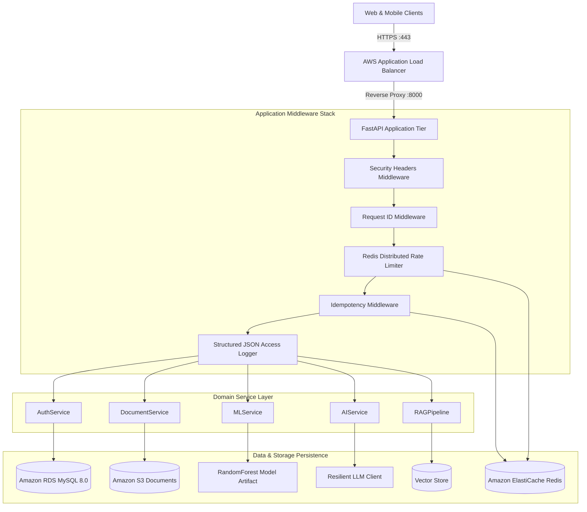

# 🚀 CareerAI — AI-Powered Job Intelligence & Fit Analysis Platform

[](https://github.com/careerai/careerai/actions)
[](https://www.python.org/downloads/)
[](https://fastapi.tiangolo.com)
[-red.svg)](https://www.sqlalchemy.org/)
[]()
[](https://github.com/astral-sh/ruff)
[](https://mypy-lang.org/)

**CareerAI** is a production-quality, enterprise-grade AI backend that helps job seekers understand how well they fit open roles, identify ranked skill gaps, receive structured interview preparation advice, and interrogate their own uploaded career documents using multi-tenant Retrieval-Augmented Generation (RAG).

---

## 🏗️ Architecture Overview



---

## ✨ Key Features

- **🔐 Enterprise Authentication & Role-Based Authorization**:
  - JWT access tokens (30 min) + rotating refresh tokens (7 days) with replay attack detection.
  - Password hashing with Bcrypt / Argon2.
  - Strict role-based permissions (`user`, `admin`).
- **📄 Document Ingestion & Validation Pipeline**:
  - Multi-format text extraction (PDF, DOCX, TXT) with `pypdf` and `python-docx`.
  - Deep magic byte verification (`%PDF`, `PK\x03\x04`), MIME whitelist, and path traversal sanitization.
  - Swappable storage abstraction (local filesystem in dev, Amazon S3 with AES-256 encryption in production).
- **🤖 Deterministic ML Compatibility Engine**:
  - 8-dimensional feature extractor (TF-IDF n-gram cosine similarity, Jaccard overlap, canonical skill taxonomy matching).
  - Trained `RandomForestRegressor` with $R^2 = 0.9927$ and sub-15ms inference latency.
  - Preloaded thread-safe singleton with heuristic fallback, version auditing on every analysis.
- **💡 Resilient LLM Integration & Graceful Degradation**:
  - Provider-agnostic interface supporting OpenAI, Azure, Anthropic, or local vLLM.
  - Automatic exponential backoff with jitter on 429/5xx errors, prompt deduplication, and SHA256 response caching.
  - Graceful degradation: if the LLM is unavailable, returns the deterministic ML score with `degraded=true` rather than breaking.
- **🔍 Multi-Tenant Document RAG with Citations**:
  - Semantic chunking (600 characters with 120 character sliding window).
  - Strict tenant isolation: searches are hard-filtered by `user_id` so users can never retrieve other users' private documents.
  - Source citations (document ID, filename, chunk index, relevance score) and hallucination rejection for unanswerable queries.
- **🛡️ Production Hardening**:
  - Redis distributed rate limiting and request idempotency via `X-Idempotency-Key`.
  - OWASP Top 10 security headers and structured JSON access logs with request IDs.
  - Background task queue (`app/workers/worker.py`) for heavy async jobs.
- **🔔 Asynchronous Webhook Notifications (Phase 12)**:
  - ATS integrators register HTTPS endpoints and subscribe to application lifecycle events (`application.created`, `application.status_changed`, `application.withdrawn`, `application.deleted`).
  - Payloads are signed with HMAC-SHA256 (`sha256=` prefix, GitHub convention) using a per-endpoint shared secret.
  - Delivery audit trail with attempt count, HTTP status, and response body. Failed deliveries retry up to 5 times on an exponential back-off schedule (30s → 5m → 30m → 2h → 6h).
  - Endpoints are auto-disabled after 10 consecutive failures. Test-ping endpoint for connectivity validation.

---

## 🛠️ Tech Stack

| Category | Technology |
|---|---|
| **Core Framework** | Python 3.12+, FastAPI, Pydantic v2, Uvicorn |
| **Database & ORM** | MySQL 8.0, SQLAlchemy 2.0 (typed async declarative), Alembic |
| **Caching & Queues**| Redis 7, redis-py async |
| **Machine Learning**| scikit-learn, NumPy, TF-IDF vectorizer, Joblib |
| **LLM & RAG** | Provider-agnostic `LLMClient`, VectorStore Protocol, Mock & OpenAI implementations |
| **Testing & Quality**| pytest, pytest-asyncio, pytest-cov (~89% coverage), HTTPX, Ruff, Mypy |
| **Infrastructure** | Docker, Docker Compose, Terraform, AWS (ECS Fargate, RDS, S3, ALB, Secrets Manager) |

---

## ⚡ Quickstart (Under 5 Minutes)

### Option A: Running with Docker Compose (Recommended)

1. Clone the repository:
   ```bash
   git clone https://github.com/careerai/careerai.git
   cd careerai
   ```
2. Start the complete stack (FastAPI + MySQL 8.0 + Redis 7):
   ```bash
   docker compose up -d
   ```
3. Verify running services:
   ```bash
   curl http://localhost:8000/health
   # {"status":"ok","app":"CareerAI","environment":"development","version":"0.1.0"}
   ```
4. Access interactive API documentation:
   - **Swagger UI**: [http://localhost:8000/docs](http://localhost:8000/docs)
   - **ReDoc**: [http://localhost:8000/redoc](http://localhost:8000/redoc)

---

### Option B: Local Virtual Environment Setup

1. Create and activate a Python 3.12+ virtual environment:
   ```bash
   python -m venv .venv
   source .venv/bin/activate  # On Windows: .venv\Scripts\activate
   ```
2. Install dependencies in editable mode:
   ```bash
   pip install -e ".[dev]"
   ```
3. Copy environment configuration:
   ```bash
   cp .env.example .env
   ```
4. Apply database migrations:
   ```bash
   alembic upgrade head
   ```
5. Start the development server:
   ```bash
   uvicorn app.main:app --reload --host 0.0.0.0 --port 8000
   ```

---

## 🧪 Running the Test Suite

CareerAI maintains an extensive test suite (159+ automated tests) achieving **~89% code coverage** across all layers:

```bash
# Run all tests with coverage report
pytest --cov=app --cov-report=term-missing

# Run code style linter
ruff check .

# Run static type checker
mypy app

# Run RAG evaluation benchmark
python scripts/eval_rag.py
```

---

## ⚙️ Environment Variables Reference

| Variable | Default | Description |
|---|---|---|
| `APP_NAME` | `CareerAI` | Application display name |
| `APP_ENV` | `development` | Environment (`development`, `test`, `production`) |
| `APP_DEBUG` | `false` | Enable verbose debug logging |
| `DATABASE_URL` | `mysql+asyncmy://...` | SQLAlchemy async connection string |
| `REDIS_URL` | `redis://localhost:6379/0` | Redis cluster connection URI |
| `SECRET_KEY` | *(32+ char random string)* | JWT HMAC-SHA256 signature key |
| `STORAGE_BACKEND` | `local` | Document storage engine (`local` or `s3`) |
| `STORAGE_LOCAL_ROOT` | `./storage/uploads` | Path for local uploads |
| `STORAGE_S3_BUCKET`| `careerai-documents` | Amazon S3 bucket name |
| `LLM_PROVIDER` | `mock` | Active LLM client (`mock` or `openai`) |
| `VECTOR_STORE_TYPE` | `memory` | Active vector store (`memory` or `chroma`) |

---

## 📚 Comprehensive Documentation Suite

- 📋 [**Product Requirements Document (PRD)**](PRD.md): Vision, user personas, functional specifications, and roadmap.
- 🏛️ [**Architecture & System Design**](docs/ARCHITECTURE.md): Component diagrams, layering rules, and scaling strategies.
- 📡 [**REST API Documentation**](docs/API.md): Detailed endpoint matrix, schemas, and example payloads.
- 🗄️ [**Database & ERD Reference**](docs/DATABASE.md): Mermaid ER diagram, indexing strategies, and migration history.
- 🧠 [**AI / ML / RAG Documentation**](docs/AI.md): Model performance ($R^2=0.9927$), feature vectors, and RAG evaluation.
- 🔒 [**Security & Compliance**](docs/SECURITY.md): OWASP Top 10 defenses, token security, and tenant isolation.
- ☁️ [**AWS Deployment Guide**](docs/DEPLOYMENT.md): Terraform Infrastructure-as-Code and ECS rolling update runbooks.
- 📊 [**Performance & Load Testing**](docs/LOAD_TESTING.md): Locust benchmarks with 617 RPS and sub-15ms ML latency.
- 📝 [**Architecture Decision Records (ADRs)**](docs/DECISIONS.md): Key technical decisions and architectural trade-offs.

---

## 💡 Key Design Decisions & Trade-offs

1. **Deterministic ML + Resilient LLM Hybrid**:
   - Rather than relying on non-deterministic LLMs for fit scoring, CareerAI uses a trained scikit-learn model for instant, reproducible scoring (<15ms) and leverages the LLM exclusively for conversational synthesis and interview coaching.
2. **Strict Multi-Tenant Isolation**:
   - Rather than relying on prompt instructions for RAG security, candidate isolation is strictly enforced at the storage/query level: all vector queries require `user_id`, preventing cross-tenant leakage.
3. **Idempotency with Replay Cache**:
   - Mutating actions (job creations, applications, analyses) can be safely retried over unreliable networks using `X-Idempotency-Key` without creating duplicate records.

---

## 🔮 Future Improvements

- **Multilingual Resume Extraction**: Expand the skill taxonomy and training pipeline across non-English CV formats.
- **Qdrant Vector Store Integration**: Plug in distributed Qdrant vector cluster for enterprise-scale multi-million vector datasets.
- **Webhook HMAC Replay Protection**: Add `X-CareerAI-Timestamp` and a ±5 minute replay window to protect against recorded-and-replay attacks.

---

## 📄 License

Distributed under the MIT License. See `LICENSE` for more information.
