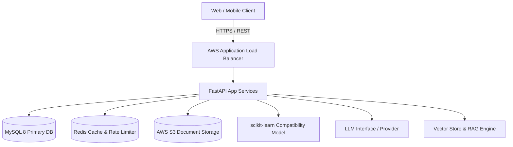

# CareerAI - AI-Powered Job Intelligence & Fit Analysis Platform

CareerAI is a production-grade, portfolio-level backend engineered with Python 3.12, FastAPI, SQLAlchemy 2.0 (typed), MySQL 8, Redis, and scikit-learn. It incorporates an agnostic LLM integration layer and document RAG (Retrieval-Augmented Generation) with strict multi-tenant privacy.

---

## Architecture Highlights



- **Layered Architecture:** Strict separation between Routers, Services, Repositories, Models, and External Adapters.
- **Async Database Layer:** SQLAlchemy 2.0 async engine with connection pooling and Alembic migrations.
- **Enterprise Security:** JWT tokens with rotation and revocation, password hashing, RBAC, and data ownership guarantees.
- **ML & AI:** Offline-trained scikit-learn compatibility model, swappable LLM clients with retry/backoff, and privacy-isolated document RAG.

---

## Quickstart (Local Development)

### 1. Prerequisites
- Python 3.12+
- Git

### 2. Environment Setup
```bash
# Clone the repository
git clone <repo-url>
cd CareerAi

# Create and activate virtual environment
python -m venv .venv
source .venv/bin/activate  # On Windows: .venv\Scripts\activate

# Install dependencies
pip install -e ".[dev]"

# Copy environment variables
cp .env.example .env
```

### 3. Run with Docker Compose
```bash
docker compose up --build
```
API Documentation will be available at:
- Swagger UI: `http://localhost:8000/docs`
- ReDoc: `http://localhost:8000/redoc`
- Liveness Probe: `http://localhost:8000/health`
- Readiness Probe: `http://localhost:8000/ready`

### 4. Running Tests
```bash
pytest
```
