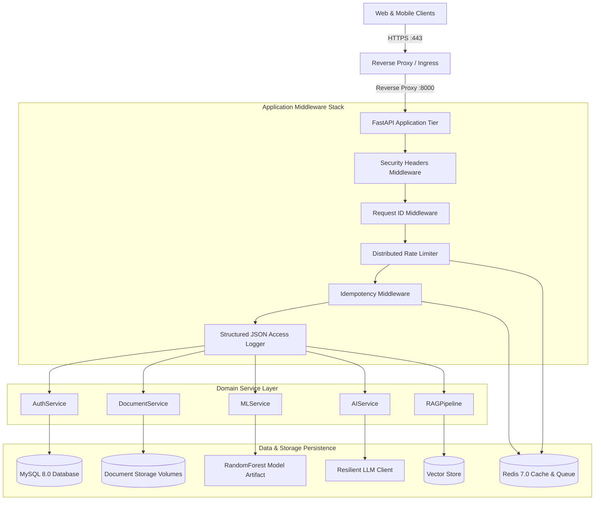

# CareerAI System Architecture

CareerAI is an enterprise-grade AI-powered job intelligence platform backend built with FastAPI, SQLAlchemy 2.0 (typed async), scikit-learn, Redis, and multi-tenant RAG.

---

## 1. High-Level System Architecture

---

## 2. Layered Architecture Principles

CareerAI adheres to strict separation of concerns across clean architectural boundaries:

1. **Routers (`app/api/v1/routes/`)**:
   - Thin HTTP controllers responsible solely for request deserialization, status codes, and dependency injection.
   - Zero business logic, zero raw SQL, zero direct DB manipulation.
2. **Services (`app/services/`)**:
   - Encapsulates pure business rules, workflow coordination, tenant validation, and caching.
   - Decoupled from HTTP requests and response models.
3. **Repositories (`app/repositories/`)**:
   - Dedicated data access objects handling SQLAlchemy 2.0 async queries, pagination filters, soft-deletion exclusions, and relationship eager loading.
4. **AI & ML Engines (`app/ml/`, `app/ai/`)**:
   - Independent analytical modules (`FeatureExtractor`, `ModelLoader`, `ResilientLLMClient`, `RAGPipeline`) loaded once at startup and isolated from request lifecycle.
5. **Core Primitives (`app/core/`)**:
   - Pydantic Settings, JWT security hashing, structured JSON logging with contextvars, custom domain exception hierarchy.

---

## 3. Horizontal Scaling & High Availability

CareerAI is completely **stateless**, enabling seamless horizontal scaling across auto-scaling container task groups / pods:

- **Shared State**: All application state resides exclusively in MySQL 8.0, Redis, and persistent storage volumes.
- **Connection Pooling**: SQLAlchemy async engine utilizes tuned connection pooling (`pool_size=20`, `max_overflow=10`, `pool_recycle=1800`, `pool_pre_ping=True`).
- **Read Replicas**: For read-heavy traffic (job searches, profile lookups), database read traffic can be directed to MySQL Read Replicas via secondary engine bindings without code modifications.
- **Background Worker**: Heavy extraction, chunking, and batch inference tasks are offloaded to asynchronous background workers (`app/workers/worker.py`) backed by Redis task queues.
- **Caching Layer**: Redis caches identical candidate analysis explanations (TTL: 30 minutes) and hot read endpoints.
