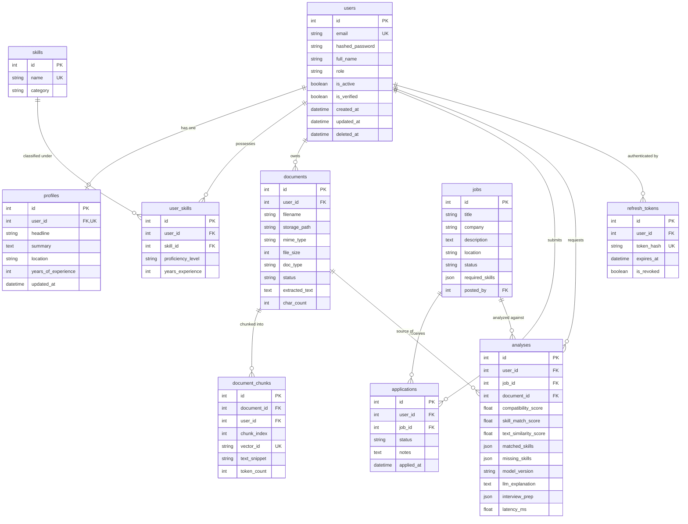

# CareerAI Database Architecture & Schema Reference

CareerAI uses **MySQL 8.0** with SQLAlchemy 2.0 (typed async declarative mapping) and Alembic for schema migrations.

---

## 1. Entity-Relationship Diagram (ERD)

---

## 2. Table Schemas & Constraints

### 2.1 `users` Table
- `email`: `VARCHAR(255)` with unique B-tree index, stored normalized in lowercase.
- `hashed_password`: Secure bcrypt / argon2 hash string.
- `role`: Enum (`user`, `admin`).
- `deleted_at`: Soft delete timestamp; filtered out on all standard select queries.

### 2.2 `documents` Table
- `user_id`: Foreign key with `ON DELETE CASCADE`.
- `status`: Enum (`uploaded`, `processing`, `ready`, `failed`).
- `doc_type`: Enum (`resume`, `cover_letter`, `career_note`, `other`).
- `storage_path`: Internal storage reference (e.g. `documents/{uuid}_{filename}`).

### 2.3 `document_chunks` Table
- `user_id`: Mandatory tenant identifier for multi-tenant vector isolation.
- `vector_id`: Unique identifier referencing the vector embedding in the vector store (`user_{uid}_doc_{did}_chunk_{idx}`).

### 2.4 `analyses` Table
- `compatibility_score`: ML computed score (0 to 100).
- `matched_skills` & `missing_skills`: Structured JSON arrays.
- `model_version`: Auditable version tag of the active ML model artifact.
- `llm_explanation` & `interview_prep`: Persisted LLM outputs for caching.

---

## 3. Indexing & Query Optimization Strategy

1. **Multi-Tenant Ownership Indexes**:
   - `idx_documents_user_status` on `(user_id, status)`: Accelerates document listings and ready checks.
   - `idx_applications_user_status` on `(user_id, status)`: Optimizes user pipeline view.
   - `idx_chunks_user_doc` on `(user_id, document_id)`: Speeds up vector deletion and chunk retrieval.
2. **Search & Filter Indexes**:
   - `idx_jobs_status_created` on `(status, created_at)`: Optimizes paginated job searches.
   - `idx_analyses_user_created` on `(user_id, created_at)`: Instant user history retrieval.
3. **Soft Delete Filter**:
   - All models inherit `SoftDeleteMixin` providing `is_deleted` and `deleted_at` fields. Repositories automatically apply `WHERE deleted_at IS NULL`.
